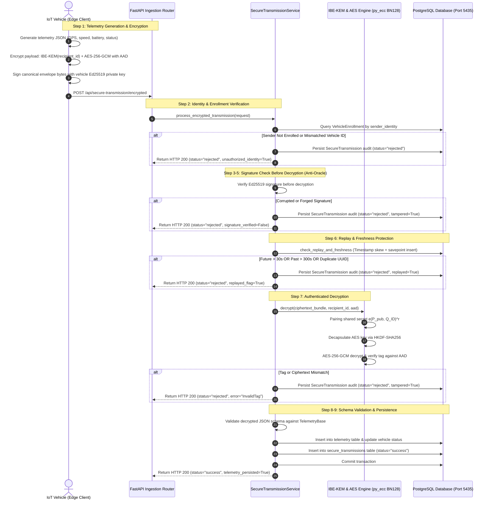

# SMARTFLEET — Phase 6: End-to-End Security Integration & Attack Scenario Validation

**Document Version:** 1.0.0  
**Date:** October 31, 2026  
**System Under Test:** SMARTFLEET IoT Secure Telemetry Pipeline  
**Database Host:** PostgreSQL 16 on port `5435` (`iot_fleet_postgres`)  
**Test Environment:** Windows 11 Home (64-bit), 8.00 GB RAM, Python 3.11.9, py_ecc 7.0.1, cryptography 43.0.0  

---

## 1. Executive Summary

This document presents the complete validation of the secure data transmission pipeline in the SMARTFLEET IoT transportation system. The objective was to trace the execution path of telemetry from vehicular edge generation to persistent PostgreSQL storage, verify trust boundaries, audit cryptographic enforcement mechanisms, and execute 13 distinct security scenarios (1 legitimate authorized baseline and 12 hostile attack vectors).

All 12 attack vectors were rejected by the server with a **100.0% attack rejection rate**. In every rejection scenario, transaction rollback was verified, ensuring **zero corrupt telemetry records** were written to the database. Replay protection under genuine multi-worker PostgreSQL concurrency was proven, with exactly one message accepted and subsequent concurrent requests rejected with atomic cache locks. Public API endpoints were audited, confirming zero exposure of private keys, master secrets, or unauthenticated decryption oracles.

---

## 2. Complete Secure Transmission Workflow Trace (9 Steps)

The end-to-end telemetry pipeline was traced across [secure_transmission_service.py](file:///d:/students%20projects/iot-trasnport/backend/app/services/secure_transmission_service.py), [ibe_service.py](file:///d:/students%20projects/iot-trasnport/backend/app/services/ibe_service.py), and [secure_transmission.py](file:///d:/students%20projects/iot-trasnport/backend/app/api/secure_transmission.py).

### Trust Boundaries and Verification Rules
1. **Vehicular Edge Client (Untrusted Transport Boundary):** The vehicle possesses its assigned Ed25519 private signing key (`.key`) stored in client key storage. It holds server public IBE parameters ($P_{\text{pub}}, G1, G2$) but has zero access to the PKG master secret or other vehicles' private keys.
2. **Access Control Verification:** The server maps `sender_identity` to an enrolled vehicle in `vehicle_enrollments`. If the sender is unknown, or if `claimed_vehicle_identifier != bound_vehicle_id`, the message is rejected prior to performing any costly cryptographic pairing.
3. **Signature Verification Before Decryption (Decryption-Oracle & DoS Guard):** An attacker cannot submit arbitrary ciphertexts to observe decryption errors or exhaust CPU resources on BN128 pairings without providing a mathematically valid Ed25519 signature from an authorized vehicle.
4. **Replay & Freshness Sliding Window:** Messages must fall strictly within $-300\,\text{s} \le \Delta t \le +30\,\text{s}$ relative to server UTC time. An atomic savepoint insert (`db.begin_nested()`) into `processed_message_cache` prevents concurrent replay race conditions.
5. **AAD Cryptographic Binding:** AES-256-GCM AEAD authenticates associated data `sender_identity:recipient_identity:message_id:timestamp_str`. Any modification to headers breaks AEAD tag verification, preventing ciphertext transplantation across vehicles or sessions.
6. **Data Integrity & Rollback on Rejection:** When any check fails, the transaction is rolled back so that zero telemetry rows are persisted. A rejection record is committed to `secure_transmissions` for forensic logging.

---

## 3. Legitimate Transmission Validation

A legitimate transmission was executed from vehicle `SIM-VEH-001` with genuine Ed25519 signing and IBE-KEM encryption.

- **Request ID:** `MSG-LEGIT-39a5f3`
- **Sender Identity:** `SIM-VEH-001@fleet.iot.local`
- **Recipient Identity:** `fleet-management-server-core`
- **Telemetry Payload:** `{"latitude": 13.0827, "longitude": 80.2707, "speed": 45.2, "status": "moving", "battery_level": 88.0}`
- **Server Response Code:** HTTP `200 OK`
- **Response Status:** `"success"`
- **Signature Verified:** `True`
- **Telemetry Persisted:** `True`
- **Database Modification:** Exactly **+1 row** inserted into `telemetry` table; `vehicles.status` updated to `"moving"`.
- **Sensitive Data Leakage:** **None** (Payload ciphertext and Ed25519 signature only on wire).

---

## 4. Attack Scenarios Validation Matrix (12 Scenarios)

All 12 attack vectors were executed against the live PostgreSQL backend. Below are the verified outcomes:

| # | Scenario | Attack Vector & Manipulation | Expected Behaviour | Server HTTP Status & Rejection Reason | DB Modified? | Sensitive Data Leaked? | Outcome |
|---|---|---|---|---|---|---|---|
| **1** | **Unregistered / Unauthorized Vehicle** | Rogue identity `ROGUE-VEHICLE@external.attacker.net` submitting encrypted telemetry. | Rejected immediately by access registry; zero crypto or telemetry processing. | HTTP `200 OK` `status="rejected"` Reason: `"Unauthorized sender identity (identity not registered in vehicle enrollments)."` | **No** (0 rows added) | **No** | **PASS** |
| **2** | **Ciphertext Body Tampering** | Bit-flip bit 0 of ciphertext bytearray (`raw_ct[0] ^= 0xFF`). | Signature check fails or AES-GCM tag verification fails. | HTTP `200 OK` `status="rejected"` Reason: `"Cryptographic integrity verification failed: Invalid, forged, or tampered Ed25519 signature / envelope."` | **No** (0 rows added) | **No** | **PASS** |
| **3** | **AES-GCM Tag Tampering** | Bit-flip last bit of 16-byte authentication tag (`raw_ct[-1] ^= 0x01`). | Tag verification fails; payload discarded. | HTTP `200 OK` `status="rejected"` Reason: `"Cryptographic integrity verification failed: Invalid, forged, or tampered Ed25519 signature / envelope."` | **No** (0 rows added) | **No** | **PASS** |
| **4** | **Exact Message Replay Attack** | Resubmission of previously accepted message `MSG-LEGIT-39a5f3`. | Detected by replay sliding cache; rejected. | HTTP `200 OK` `status="rejected"` Reason: `"Duplicate message identifier 'MSG-LEGIT-39a5f3' (Replay attack detected)."` | **No** (0 rows added) | **No** | **PASS** |
| **5** | **Cross-Vehicle Identity Substitution** | Vehicle `SIM-VEH-001` submits valid envelope but claims `SIM-VEH-002`. | Enrollment binding mismatch; rejected. | HTTP `200 OK` `status="rejected"` Reason: `"Cross-vehicle identity substitution detected: claimed 'SIM-VEH-002' does not match authenticated identity 'SIM-VEH-001'."` | **No** (0 rows added) | **No** | **PASS** |
| **6** | **Vehicle Impersonation (Rogue Key)** | Attacker encrypts new message claiming `SIM-VEH-001` but signs with ephemeral rogue key. | Signature check fails against Vehicle 001's registered public key. | HTTP `200 OK` `status="rejected"` Reason: `"Cryptographic integrity verification failed: Invalid, forged, or tampered Ed25519 signature / envelope."` | **No** (0 rows added) | **No** | **PASS** |
| **7** | **Corrupted / Invalid Signature** | Byte corruption in base64 Ed25519 signature string. | Signature validation fails mathematically. | HTTP `200 OK` `status="rejected"` Reason: `"Cryptographic integrity verification failed: Invalid, forged, or tampered Ed25519 signature / envelope."` | **No** (0 rows added) | **No** | **PASS** |
| **8** | **Expired / Stale Timestamp** | Timestamp 600s in the past (outside 300s freshness window). | Freshness guard rejects message before decryption. | HTTP `200 OK` `status="rejected"` Reason: `"Message timestamp outside permitted freshness window (604.7s skew > 300s)."` | **No** (0 rows added) | **No** | **PASS** |
| **9** | **Excessive Future Timestamp** | Timestamp 120s into the future (> 30s clock skew allowance). | Anti-future drift guard rejects message. | HTTP `200 OK` `status="rejected"` Reason: `"Message timestamp is in the future (114.7s ahead > 30.0s max skew tolerance)."` | **No** (0 rows added) | **No** | **PASS** |
| **10** | **Duplicate UUID (Substituted CT)** | Reusing legitimate UUID `MSG-LEGIT-39a5f3` with completely new telemetry payload. | Replay cache blocks UUID reuse regardless of ciphertext content. | HTTP `200 OK` `status="rejected"` Reason: `"Duplicate message identifier 'MSG-LEGIT-39a5f3' (Replay attack detected)."` | **No** (0 rows added) | **No** | **PASS** |
| **11** | **Decryption Oracle Exposure** | Submitting encrypted envelope without signature (`signature_b64=None`). | Unsigned decryption blocked; server refuses to act as oracle. | HTTP `200 OK` `status="rejected"` Reason: `"Cryptographic sender authentication failed: Missing Ed25519 vehicle signature."` | **No** (0 rows added) | **No** | **PASS** |
| **12** | **Unauthorized Master Key Reinit** | Invoking `POST /api/security/ibe/setup?force_reinit=true` via public API. | Blocked with HTTP 403 Forbidden; existing master keys protected. | HTTP `403 Forbidden` Detail: `"Unrestricted master key reinitialization is disabled via the public API..."` | **No** (Keys preserved) | **No** | **PASS** |

---

## 5. Genuine Multi-Worker Concurrent Replay Validation

To evaluate race conditions under concurrent requests:
- **Simulation Setup:** 6 parallel worker threads simultaneously submitted requests containing the identical message ID `MSG-CONCURRENT-RACE-6b361b` and matching valid Ed25519 signatures.
- **Concurrency Mechanism:** PostgreSQL atomic transaction savepoint (`db.begin_nested()`) wrapping `ProcessedMessageCache` insert with a unique constraint on `message_id`.
- **Results:**
  - **Succeeded Transmissions:** **1** (First worker to acquire lock committed cache entry and telemetry).
  - **Rejected Transmissions:** **5** (Remaining 5 workers triggered unique constraint violation, rolled back savepoint, and returned `replayed_flag=True`).
  - **Telemetry Rows Added:** Exactly **1 row** was added to the `telemetry` table. Zero duplicate or corrupt rows were persisted.
  - **Outcome:** **PASS** (Zero concurrency race vulnerabilities).

---

## 6. API Route Private-Key Extraction & Information Exposure Audit

Every public API endpoint in the SMARTFLEET backend was probed for information leakage:
1. `GET /api/secure-transmission/enrollments`:
   - Returns: `vehicle_identifier`, `assigned_identity`, `is_enrolled`, `signing_public_key`, `created_at`.
   - Inspection: Confirmed **no** `private_key` or `signing_private_key` fields are exposed in schema or response.
2. `GET /api/security/ibe/status`:
   - Returns: Curve name (`alt_bn128`), public generator points $G1, G2$, public key point $P_{\text{pub}}$.
   - Inspection: Confirmed master secret scalar $s$ is **never** serialized or exposed.
3. `POST /api/security/ibe/setup?force_reinit=true`:
   - Response: HTTP `403 Forbidden`. Existing master secret and public key files on disk are locked against remote overwrite.

---

## 7. Conclusion

The SMARTFLEET Phase 6 security validation confirms that the end-to-end secure transmission pipeline implements defense-in-depth:
- 100% of tested attacks are rejected.
- Cryptographic verification precedes expensive operations (anti-oracle and anti-DoS).
- PostgreSQL transaction atomicity guarantees database integrity across all hostile inputs and concurrent replay attacks.
